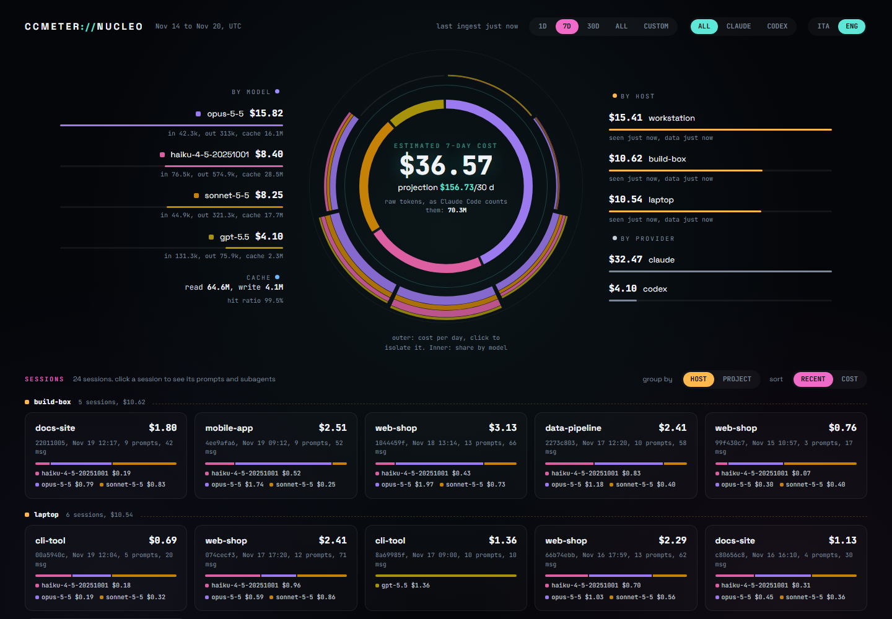

<p align="center">
  
</p>

<h1 align="center">ccmeter</h1>

<p align="center">
  <b>Self-hosted token and cost tracker for Claude Code and Codex, across all your machines.</b>
</p>

<p align="center">
  
  
  
  
  
</p>

<p align="center">
  
</p>

ccmeter reads the transcripts that Claude Code and Codex already write on your machines, keeps
only the numbers (tokens per request, model, time, session) and shows what that usage would
cost at API list prices: per day, per model, per machine, per session and per prompt. Run it on
one computer, or put the server on a home server or a small VPS and let every machine you code
on report to it.

- **One number per request, once.** Claude Code writes the same API response on several lines
  (streaming chunks, parallel tool calls); ccmeter counts each response once, by message id.
- **No conversation leaves your machine.** The agent drops prompts, answers, tool inputs and
  outputs and working directories before sending anything; what travels is counters, ids,
  timestamps, model names and the project folder name.
- **Any period, exactly.** Pick a day, a week, a month or any range: every number on the
  dashboard, down to a single prompt, covers exactly that period.
- **Claude Code and Codex side by side**, with a filter to see either one alone.
- **Small and boring to run.** One Python package, one SQLite file, no external services, a
  dashboard that loads nothing from the internet.

> Costs are estimates at public API list prices (`prices.json`). With a subscription you do not
> pay per token: read them as "what this usage would cost through the API".

## How it works

```
 your machines                                   one server (can be the same machine)
 ┌──────────────────────────────┐               ┌─────────────────────────────────────┐
 │ ~/.claude/projects/**.jsonl  │               │                                     │
 │ ~/.codex/sessions/**.jsonl   │  HTTP over    │  ccmeter server                     │
 │            │                 │  LAN or VPN   │   POST /ingest  (token)             │
 │   ccmeter agent ─────────────┼──────────────>│   SQLite: usage records             │
 │   keeps counters only        │  numbers only │   GET /dashboard/   GET /api/...    │
 └──────────────────────────────┘               └─────────────────────────────────────┘
```

The **agent** (`ccmeter agent`, the client) watches the transcript folders, reads only what was
appended since its last pass and sends it in small batches. It remembers how far it got, so a
restart or a server outage loses nothing. The **server** (`ccmeter server`) stores the records,
deduplicates them and computes costs when you look, so a price update applies to the whole
history. `ccmeter local` runs both on one machine.

## Quick start: one computer

You need [uv](https://docs.astral.sh/uv/) (it fetches Python 3.15 for you).

```bash
uv tool install "ccmeter[server] @ git+https://github.com/ArzMat/ccmeter"
ccmeter local
```

Open <http://127.0.0.1:8787/dashboard/>. The first pass reads your whole history, which can
take a few minutes on a large one; after that new usage shows up within seconds.

`ccmeter local` keeps its database in `~/.ccmeter/ccmeter.db` and listens only on
`127.0.0.1`. Stop it with Ctrl+C; the next start resumes where it stopped.

## Several computers

Pick the machine that hosts the server: a home server, a NAS, a small VPS or simply your
desktop. Every other machine runs only the agent.

**1. The server**

```bash
uv tool install "ccmeter[server] @ git+https://github.com/ArzMat/ccmeter"
export CCMETER_API_TOKEN="$(python3 -c 'import secrets; print(secrets.token_hex(32))')"
ccmeter server run --host 192.168.1.10 --port 8787
```

`--host` is the address the agents will reach: the server's LAN or VPN address (Tailscale,
WireGuard). Keep the token: every agent needs it. On Windows set the variable with
`$env:CCMETER_API_TOKEN = "..."`. To run it as a service, see [Run at startup](#run-at-startup).

**2. Each machine you code on**

```bash
uv tool install "ccmeter @ git+https://github.com/ArzMat/ccmeter"
ccmeter agent init --server http://192.168.1.10:8787
ccmeter agent run
```

The agent needs no server dependencies. `agent init` asks for the server's token without
echoing it (or reads it from `CCMETER_API_TOKEN`) and writes `~/.ccmeter/agent.json` (readable
only by you); `--token` works too, but leaves the token in the process list and in your shell
history. The machine shows up on the dashboard under its hostname, or under the name you
pass with `--host-label`. The server machine can run an agent too, to count its own usage.

**Keep the server private.** Only `/ingest` requires the token: the dashboard and the read API
are open to whoever can reach the port. Bind the server to a private interface (LAN, VPN,
Tailscale) or to `127.0.0.1` behind your own authenticated reverse proxy, never to the public
internet.

Each host on the dashboard shows when it was last seen and when it last sent usage: an idle
agent still sends a heartbeat every five minutes, so a silent host is a stopped agent.

## Run at startup

| Where | How |
|---|---|
| Windows agent | `deploy/windows/install-agent.ps1 -Server http://SERVER:8787`: writes the config if missing (asking for the token) and starts the agent hidden at every login (no administrator rights needed). |
| Linux server | `deploy/linux/ccmeter-server.service`: systemd unit, database in `/var/lib/ccmeter`, token in `/etc/ccmeter.env`. Instructions inside the file. |
| Linux agent | `deploy/linux/ccmeter-agent.service`: systemd user unit (`systemctl --user`). |
| macOS agent | Run `ccmeter agent run` at login with a LaunchAgent, or from a terminal you keep open. |

## What is read, what is sent, what is stored

| | Claude Code | Codex |
|---|---|---|
| Read on your machine | `~/.claude/projects/**/*.jsonl` | `~/.codex/sessions/**/rollout-*.jsonl` and `~/.codex/archived_sessions` |
| Sent to the server | the machine's host label; for each line, the transcript's path relative to `~/.claude/projects` and the line's byte offset (to tell lines apart and drop duplicates), and the line reduced to its type, ids, timestamp, session, sidechain flag, model and token counters; message contents keep only their shape (a string becomes `""`, a list keeps each block's type) | the machine's host label; one numeric record per model request: ids, timestamp, model, project folder name, token counters |
| Never sent | prompts, answers, tool inputs and outputs, attachments, the working directory (`cwd`) and every other field of the line | conversation text, tool calls, working directories |

The relative path starts with the transcript's folder under `~/.claude/projects`, which Claude
Code names after the path you worked in (for example `C--work-web-shop`): the server shows it
as the project of the session, so whoever can open the dashboard sees these folder names.
Details and the exact fields: [docs/privacy.md](docs/privacy.md).

Upgrading from a version before 1.0 that stored whole transcript lines? Stop the server and run
`ccmeter server backup`, then `ccmeter server minimize --dry-run`, `--yes` and
`ccmeter server vacuum --yes`: see [docs/privacy.md](docs/privacy.md#cleaning-an-older-database).

## Costs and prices

Costs come from [`src/ccmeter/server/prices.json`](src/ccmeter/server/prices.json): dollars per
million tokens for input, output, cache reads and cache writes (5 minutes and 1 hour), with the
date each entry was checked. The first entry whose `match` text appears in the model name wins,
so specific names come before generic ones; OpenAI entries use exact names. Models whose price
depends on the size of each request (OpenAI over 272,000 tokens, Claude Haiku 5.5 over 100,000)
are priced request by request. A model without an entry is shown as "no price" on the dashboard and left out
of the totals rather than guessed.

To use your own prices: `ccmeter server run --prices my-prices.json` (or `CCMETER_PRICES_PATH`).
Everything is recomputed on the next refresh. More in [docs/pricing.md](docs/pricing.md).

**Why other counters show different numbers.** Claude Code's own counters add up every
transcript line, and the same API response is written several times; the dashboard shows that
figure as "raw tokens" next to the deduplicated one. Codex forks copy their parent's events;
ccmeter drops the copies. The `codex-auto-review` guardian agents are not counted: their price
is not public.

## Commands

| Command | What it does |
|---|---|
| `ccmeter local` | server and agent on this machine, no configuration |
| `ccmeter agent init --server URL` | write `~/.ccmeter/agent.json` (asks for the token) |
| `ccmeter agent run [--once]` | ship new usage (forever, or one pass) |
| `ccmeter server run [--host] [--port] [--db] [--prices]` | start the server (token in `CCMETER_API_TOKEN`) |
| `ccmeter server report [--days N]` | cost of the last N days in the terminal |
| `ccmeter server backup DEST` | consistent copy of the live database |
| `ccmeter server minimize --dry-run \| --yes` | drop conversation text stored by older versions |
| `ccmeter server vacuum --yes` | give freed space back to the disk |
| `ccmeter server reprocess` | rebuild the Claude records from the stored lines |

Maintenance commands (`minimize`, `vacuum`, `reprocess`) refuse to run while the server is
running on the same database.

Server settings can also come from the environment: `CCMETER_API_TOKEN`, `CCMETER_DB_PATH`,
`CCMETER_PRICES_PATH`. The agent's `agent.json` takes `server_url`, `api_token`, `host_label`,
`claude_projects_dir`, `poll_seconds` and `codex_dirs` (`[]` turns Codex off).

## API

Read endpoints accept `from` and `to` (`YYYY-MM-DD`, UTC, both included), `host`, `model` and
`provider` (`claude` or `codex`).

| Endpoint | Returns |
|---|---|
| `GET /api/health` | last ingest, hosts, per-host last contact and last delivery |
| `GET /api/summary` | tokens and cost by model, host and provider |
| `GET /api/spend/daily` | cost per day and model, monthly projection |
| `GET /api/sessions`, `GET /api/sessions/{id}` | sessions, and one session's prompts and messages |
| `GET /api/subagents` | subagent usage |
| `GET /api/dashboard/overview` | what the dashboard draws, per day |
| `GET /api/dashboard/session-list`, `.../session-detail/{id}` | sessions of a period, and one session in detail |
| `POST /ingest` | agent uploads (bearer token) |

Shapes and examples: [docs/api.md](docs/api.md). How the pieces fit:
[docs/architecture.md](docs/architecture.md).

## Development

```bash
git clone https://github.com/ArzMat/ccmeter && cd ccmeter
uv sync --extra server
uv run pytest
uv run ruff check && uv run ruff format --check && uv run pyright
uv run python scripts/demo_data.py --db demo.db   # invented data for the dashboard
CCMETER_API_TOKEN=demo uv run ccmeter server run --db demo.db
```

The dashboard is plain files in `src/ccmeter/server/static/` (Preact and htm, no build step).

## License

MIT, see [LICENSE](LICENSE). The dashboard bundles Preact (MIT), htm (Apache-2.0) and the
Space Grotesk and JetBrains Mono fonts (SIL OFL 1.1): see
[THIRD_PARTY_NOTICES.md](THIRD_PARTY_NOTICES.md).
